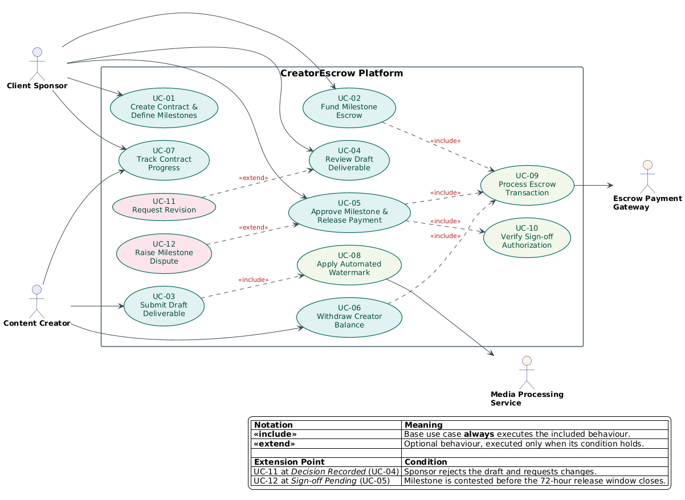

# CreatorEscrow — Freelance Content Creator Escrow Platform

**Lab 1: Requirements Engineering & UML Use-Case Modelling**
**Problem Statement #53 — Media, Events & Community**
PES University · Department of Computer Science & Engineering

| | |
|---|---|
| **Name** | Harsh Mannan |
| **SRN** | PES2UG24CS183 |
| **Section / Semester** | 5-C |
| **Course** | Software Engineering |

---

## Overview

CreatorEscrow is a freelance contract management platform for paid media work. A **Client Sponsor** defines milestones and locks funds in escrow before work begins; a **Content Creator** submits draft deliverables that the platform automatically watermarks, so the sponsor can evaluate the work without being able to use it. Funds move to the creator only on an authenticated, audited milestone sign-off — and the un-watermarked masters move to the sponsor in the same atomic transaction.

The design centres on one asymmetry: neither party wants to go first. Escrow plus watermarking removes the need for either of them to.

---

## Submission PDFs (Google Form)

| Form field | Upload this file |
|---|---|
| **Requirements Table** | [`submission/Requirements-Table_PS53.pdf`](submission/Requirements-Table_PS53.pdf) — 4 pages · Word version: [`Requirements-Table_PS53.docx`](submission/Requirements-Table_PS53.docx) |
| **UML Use case** | [`submission/UML-UseCase_PS53.pdf`](submission/UML-UseCase_PS53.pdf) — 4 pages (diagram, catalogues, relationship rationale, state model, and the UC-05 flow spec as an appendix) |

The form accepts either a PDF or a document, so use whichever you prefer for the requirements table.

Regenerate with:

```bash
python3 build/parse_requirements.py                     # docs/01-requirements.md -> build/requirements.json
python3 build/build_pdfs.py       "Harsh Mannan" "PES2UG24CS183"
node    build/build_docx.js       "Harsh Mannan" "PES2UG24CS183" submission/Requirements-Table_PS53.docx
```

`docs/01-requirements.md` is the single source of truth — the PDF and the Word file are both generated from it, so editing the Markdown and re-running the three commands keeps all three in sync.

## Deliverables

| # | Deliverable | Document |
|---|---|---|
| 1 | Complete Requirements Table — 5 FRs + 2 NFRs with ID, Type, Description, Priority, Acceptance Criteria, Rationale | **[docs/01-requirements.md](docs/01-requirements.md)** |
| 2 | UML Use-Case Diagram — all actors, primary use cases, «include» and «extend» relationships | **[docs/02-use-case-diagram.md](docs/02-use-case-diagram.md)** |
| 3 | Use-Case Flow Specification — UC-05, with preconditions, postconditions, main success scenario, and one alternate flow | **[docs/03-use-case-flow-UC-05.md](docs/03-use-case-flow-UC-05.md)** · one-page print version: **[PDF](docs/03-use-case-flow-UC-05.pdf)** |

### Use-Case Diagram



---

## Requirements at a Glance

| ID | Type | Priority | Summary |
|---|---|---|---|
| FR-001 | Contract Management | High | Create contract and define mutually accepted milestones. |
| FR-002 | Escrow / Financial | High | Fund a milestone; lock the amount in escrow. |
| FR-003 | Media Asset Handling | High | Submit versioned drafts; expose only watermarked previews. |
| FR-004 | Review Workflow | Medium | Record one decision per version — approve or request revision. |
| FR-005 | Escrow / Financial | High | Release escrow on authenticated sign-off; transfer asset rights. |
| NFR-001 | Performance & Security | High | Watermarked preview ready in ≤ 5 s (p95) at 200 concurrent uploads. |
| NFR-002 | Security & Reliability | High | ACID, idempotent, hash-chain-audited escrow; ≥ 99.9 % availability. |

Full descriptions, acceptance criteria, rationale, and the requirements traceability matrix are in **[docs/01-requirements.md](docs/01-requirements.md)**.

---

## Repository Structure

```
.
├── README.md                          # This file — submission index
├── docs/
│   ├── 01-requirements.md             # Deliverable 1: FR/NFR table + traceability matrix
│   ├── 02-use-case-diagram.md         # Deliverable 2: diagram, catalogues, relationship rationale
│   ├── 03-use-case-flow-UC-05.md      # Deliverable 3: one-page flow specification
│   ├── 03-use-case-flow-UC-05.pdf     # Deliverable 3: typeset, verified single page
│   └── 03-use-case-flow-UC-05.html    # Print source for the PDF above
├── diagrams/
│   ├── use-case-diagram.puml          # PlantUML source (the editable model)
│   ├── use-case-diagram.png / .svg    # Raster + vector exports
│   ├── milestone-state-machine.puml   # Supporting state model
│   └── milestone-state-machine.png / .svg
├── build/
│   ├── print.css                      # Shared print stylesheet
│   ├── parse_requirements.py          # Markdown -> JSON, so the Word file can't drift
│   ├── build_pdfs.py                  # Regenerates both submission PDFs
│   └── build_docx.js                  # Regenerates the Word requirements table
└── submission/
    ├── Requirements-Table_PS53.pdf    # Google Form upload 1 (PDF)
    ├── Requirements-Table_PS53.docx   # Google Form upload 1 (Word alternative)
    └── UML-UseCase_PS53.pdf           # Google Form upload 2
```

## Regenerating the Diagram

```bash
# Requires Java 8+ and plantuml.jar (https://plantuml.com/download)
java -jar plantuml.jar -tpng diagrams/use-case-diagram.puml
java -jar plantuml.jar -tsvg diagrams/use-case-diagram.puml
```

## Pushing to GitHub

```bash
git init
git add .
git commit -m "Lab 1: Requirements Engineering & UML Use-Case Modelling (PS #53)"
git branch -M main
git remote add origin https://github.com/<your-username>/<repo-name>.git
git push -u origin main
```

---

## Assumptions

1. A single currency per contract; multi-currency conversion is out of scope.
2. KYC and payment-instrument verification are handled by the external Escrow Payment Gateway.
3. Dispute *arbitration* is performed by a human process outside the system; the platform models only the `DISPUTED` hold and the resulting resolution states.
4. The platform fee is a fixed percentage configured per contract at creation time.
5. UC-06 (*Withdraw Creator Balance*) and UC-07 (*Track Contract Progress*) appear in the use-case model for boundary completeness but are deferred beyond the five mandated functional requirements — see the scope note in Deliverable 1.
