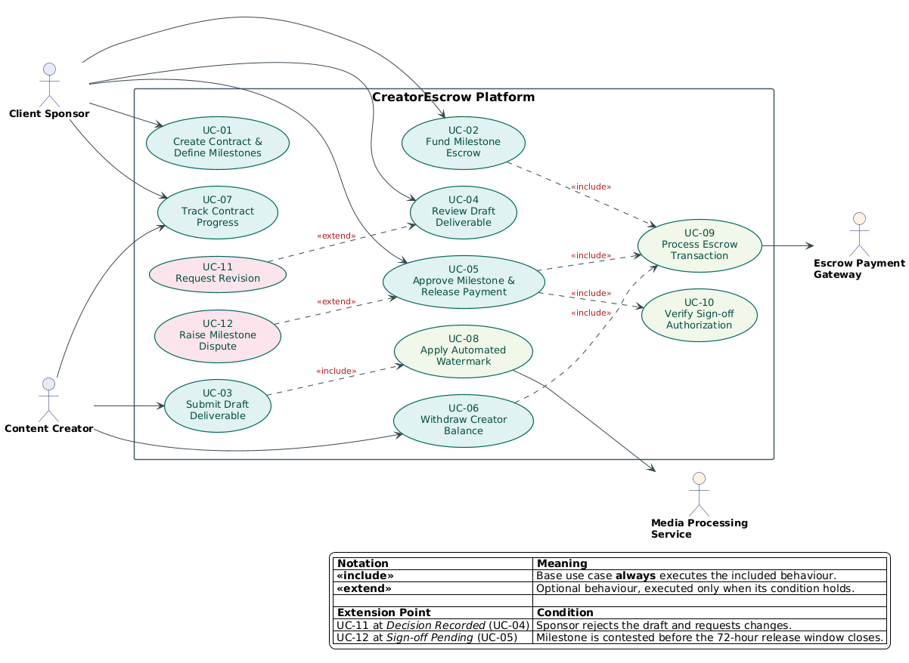
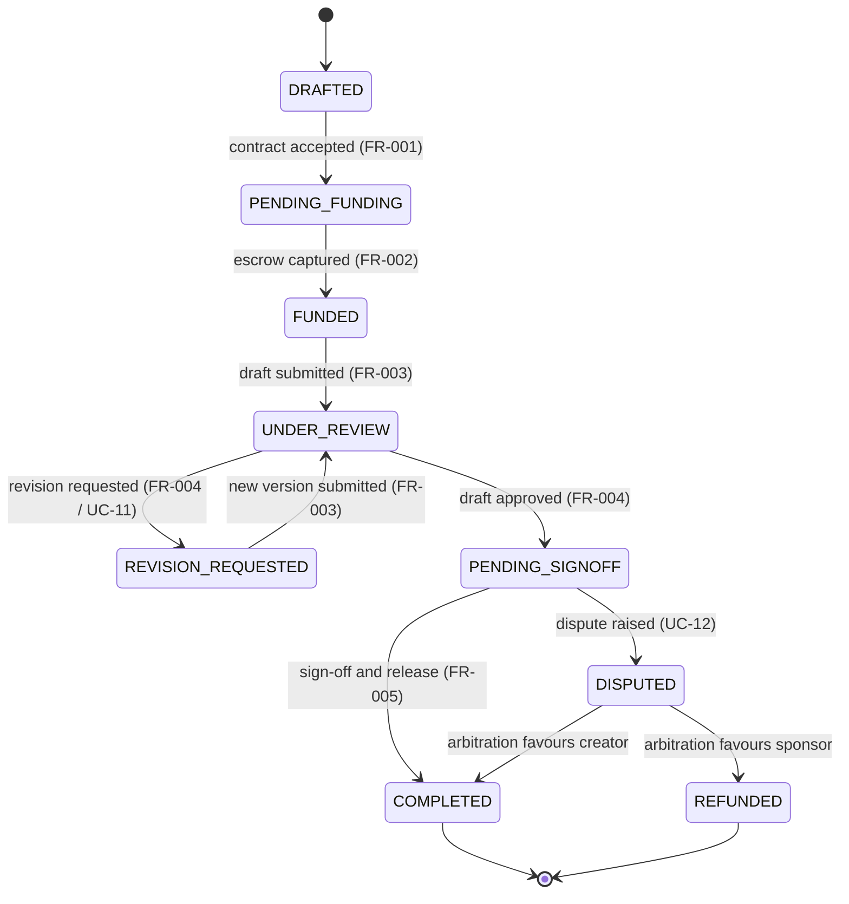

# UML Use-Case Diagram

**System:** CreatorEscrow — Freelance Content Creator Escrow Platform
**Document:** Deliverable 2 of 3 — Use-Case Model

---

## 1. Diagram



*Source: [`diagrams/use-case-diagram.puml`](../diagrams/use-case-diagram.puml) · Vector export: [`use-case-diagram.svg`](../diagrams/use-case-diagram.svg)*

Regenerate with:

```bash
java -jar plantuml.jar -tpng diagrams/use-case-diagram.puml
java -jar plantuml.jar -tsvg diagrams/use-case-diagram.puml
```

---

## 2. Actor Catalogue

| Actor | Classification | Goal in the System |
|---|---|---|
| **Content Creator** | Primary, human | Upload work that cannot be used until it is paid for, and get paid once a milestone is approved. |
| **Client Sponsor** | Primary, human | Pay safely, see the work before committing the money, and get the usable final files. |
| **Media Processing Service** | Supporting, external | Convert the uploads and add the watermark. It is called by the system; it never starts anything itself. |
| **Escrow Payment Gateway** | Supporting, external | Collect, hold, and transfer the money, and confirm when a payment has actually gone through. |

The two supporting actors are drawn **outside** the system boundary on the right, and the system only reaches them *through* a use case. The platform depends on them but does not build them itself.

---

## 3. Use-Case Catalogue

| ID | Use Case | Primary Actor | Notes |
|---|---|---|---|
| UC-01 | Create Contract & Define Milestones | Client Sponsor | Entry point of the contract lifecycle. |
| UC-02 | Fund Milestone Escrow | Client Sponsor | «include» UC-09. |
| UC-03 | Submit Draft Deliverable | Content Creator | «include» UC-08. |
| UC-04 | Review Draft Deliverable | Client Sponsor | Extension point *Decision Recorded*. |
| UC-05 | Approve Milestone & Release Payment | Client Sponsor | «include» UC-09, UC-10. Extension point *Sign-off Pending*. **Detailed in Deliverable 3.** |
| UC-06 | Withdraw Creator Balance | Content Creator | «include» UC-09. |
| UC-07 | Track Contract Progress | Both primary actors | A read-only view of what state each milestone is in. |
| UC-08 | Apply Automated Watermark | — (included) | Delegates to Media Processing Service. |
| UC-09 | Process Escrow Transaction | — (included) | Calls the Escrow Payment Gateway. Repeating the same request never pays twice (NFR-002). |
| UC-10 | Verify Sign-off Authorization | — (included) | Makes the sponsor log in again and records a sign-off they cannot later deny. |
| UC-11 | Request Revision | — (extending) | Conditional on sponsor rejecting a draft. |
| UC-12 | Raise Milestone Dispute | — (extending) | Conditional on the milestone being contested. |

---

## 4. Relationship Justification

### «include» — mandatory, unconditional sub-behaviour

| Relationship | Why it is an *include* |
|---|---|
| UC-03 **«include»** UC-08 *Apply Automated Watermark* | Every single upload gets watermarked — there is no way through UC-03 that skips it, because skipping it would hand the original file to the sponsor for free (FR-003, NFR-001). It is written as a separate use case because the work is actually done by an outside service. |
| UC-02 / UC-05 / UC-06 **«include»** UC-09 *Process Escrow Transaction* | All three of these move money, and all three need the same safety checks and the same audit log entry (NFR-002). Pulling that out into one shared use case means the riskiest part of the system is written once instead of three separate times. |
| UC-05 **«include»** UC-10 *Verify Sign-off Authorization* | Money is never released without checking who is signing off (FR-005). This check runs every time, and "every time" is exactly what makes it an include rather than an extend. |

### «extend» — optional behaviour at a named extension point

| Relationship | Extension Point | Condition |
|---|---|---|
| UC-11 *Request Revision* **«extend»** UC-04 | *Decision Recorded* | Only happens if the sponsor rejects the draft instead of approving it. Reviewing is a complete use case by itself, so asking for changes is an optional add-on. |
| UC-12 *Raise Milestone Dispute* **«extend»** UC-05 | *Sign-off Pending* | Only happens if either side objects to the milestone within the 72-hour window. It interrupts the release and keeps the money locked in `DISPUTED` (FR-005). |

> **Arrow direction.** In UML an `«extend»` arrow points **from** the extending use case **to** the base use case, while an `«include»` arrow points **from** the base use case **to** the one being included. The diagram follows this exactly, which is an easy mark to lose if the arrows are drawn the other way round.

---

## 5. Milestone State Model (supporting view)

All of the use cases above work on one milestone state machine. It is included here so the conditions used in the flow specification are clear.


