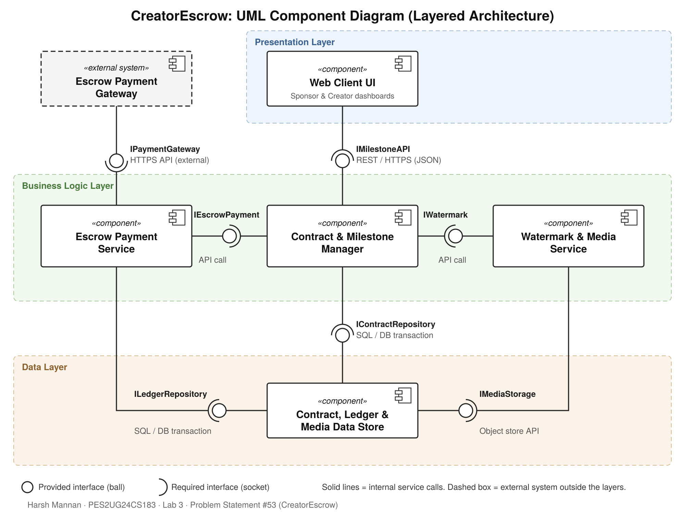

# Lab 3: Component Modelling & Architectural Pattern Selection

**Scenario:** CreatorEscrow (Problem Statement #53), continued from Lab 1 (traces to FR-001 to FR-005, NFR-001, NFR-002)
**Architecture chosen:** Layered (Presentation, Business Logic, Data)

| File | Description |
|------|-------------|
| `component_diagram.png` / `.pdf` / `.svg` | UML component diagram: 5 components + external payment gateway, 7 provided/required interfaces |
| `Lab3_Justification_PES2UG24CS183.pdf` | One-page written justification (Word version also included) |

